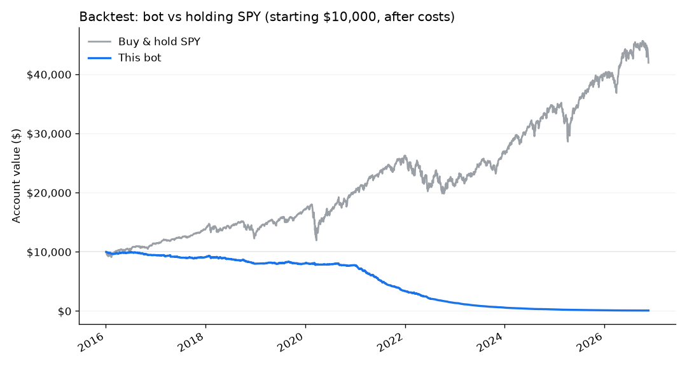

# Backtest report - Paper Bot #2

_Generated 2026-11-20 01:27 UTC from Alpaca historical data._

Period: **2016-01-04 to 2026-11-19** · starting capital $10,000.00

## Verdict

**The bot did NOT beat simply holding SPY.** It returned -99.16% vs +319.42% for SPY.
On average only 24% of the account was invested, because 1%-risk sizing with tight stops keeps positions small - the rest sits in cash.

## Bot vs buy-and-hold SPY

| | Bot | Hold SPY |
|---|---|---|
| Final value | $83.74 | $41,942.23 |
| Total return | -99.16% | +319.42% |
| Yearly return (CAGR) | -35.58% | +14.09% |
| Worst drawdown | -99.16% | -33.79% |
| Sharpe ratio | -5.48 | 0.84 |

## Year by year

| Year | Bot | Hold SPY |
|---|---|---|
| 2016 | -5.60% | +13.00% |
| 2017 | -3.63% | +21.75% |
| 2018 | -12.09% | -4.96% |
| 2019 | +0.41% | +31.14% |
| 2020 | -3.48% | +18.45% |
| 2021 | -56.25% | +28.60% |
| 2022 | -59.89% | -18.18% |
| 2023 | -57.66% | +26.18% |
| 2024 | -54.07% | +24.89% |
| 2025 | -53.74% | +17.72% |
| 2026 | -31.53% | +5.80% |

## Trades

6998 trades · win rate 28% · average $-1.42 per trade · fees + slippage paid $10,165.05 · days halted by the 3% loss rule: 4

| Market | Strategy | Trades | Win rate | Total P&L | Avg P&L |
|---|---|---|---|---|---|
| BTC/USD | mean_reversion | 5604 | 23% | $-7,955.40 | $-1.42 |
| GLD | trend | 21 | 52% | $96.84 | $4.61 |
| QQQ | mean_reversion | 415 | 47% | $-998.41 | $-2.41 |
| SPY | mean_reversion | 939 | 46% | $-1,451.32 | $-1.55 |
| USO | trend | 19 | 37% | $392.26 | $20.65 |

| Exit reason | Trades | Total P&L |
|---|---|---|
| back to average | 3528 | $7,379.32 |
| end of day | 234 | $-233.03 |
| stop loss | 3208 | $-18,429.37 |
| trend ended | 28 | $1,367.05 |

## Data used

| Market | Bars | From | To |
|---|---|---|---|
| BTC/USD (15-min) | 206,062 | 2021-01-01 | 2026-11-20 |
| QQQ (15-min) | 71,155 | 2016-01-04 | 2026-11-19 |
| SPY (15-min) | 71,160 | 2016-01-04 | 2026-11-19 |
| GLD (daily) | 2,737 | 2016-01-04 | 2026-11-19 |
| USO (daily) | 2,737 | 2016-01-04 | 2026-11-19 |

## Assumptions and caveats

- Costs: stock slippage 0.03% per side; BTC slippage 0.05% + fee 0.25% per side. Stock commissions are $0 at Alpaca.
- Trades fill at the next bar's open after a signal. Stops fill at the stop price, or at the open if price gapped through it.
- GLD/USO stops are checked on daily bars, so their timing within a day is approximate.
- Each market only trades once its data exists (BTC history on Alpaca is shorter than stock history).
- Historical SIP data is used here; the live bot reads the free IEX feed, so live signals can differ slightly.
- A backtest is not a promise. Real fills, data gaps and GitHub scheduling delays will make live results worse.
